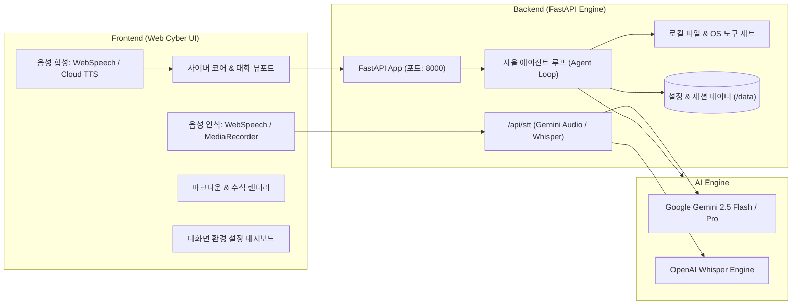

# 🌌 MINORI (미노리)
> **개인 자율형 디지털 비서 (Autonomous Personal Digital Secretary)**  
> *"아이언맨의 자비스(J.A.R.V.I.S)처럼, 당신의 일상과 로컬 PC 환경을 스스로 보조하는 지능형 파트너"*

<div align="center">


</div>

---

## 프로젝트 소개 (Overview)

**MINORI(미노리)**는 웹 브라우저 안에서 단순한 질의응답만 반복하는 일반적인 챗봇의 한계를 넘어서 
**사용자의 로컬 PC 환경을 직접 인지하고, 음성으로 대화하며, 자율적으로 도구(Tools)를 실행하여 작업을 대신 완수하는 지능형 AI 비서 시스템**으로 만들고자 합니다.

반응형 **사이버 코어(Cyber Core)** 인터페이스를 기반으로, 
로어북(Lorebook) & 모듈형 규칙 주입 엔진, 정규식/트리거 매크로 파이프라인, 그리고 고정밀 음성 인식(STT)과 합성(TTS)을 완벽하게 통합하고자 했습니다.

---

## 핵심 기능 (Key Features)

### 1. 자율 음성 상호작용 (Dual-Engine STT & Multilingual TTS)
- **실시간 음향 교정 필터 (Web Speech API)**: 고유명사 '미노리'를 '며느리', '미누리' 등으로 오인식하는 음향 편차를 실시간으로 100% 감지 및 자동 교정.
- **고정밀 멀티모달 STT (Google Gemini 2.5 Audio & OpenAI Whisper)**: 마이크 오디오를 고정밀 AI 모델에 전송하여 잡음 환경이나 전문 용어도 단어 힌트(Prompt Keywords)를 바탕으로 완벽하게 전사.
- **다국어 TTS 음성 합성**: Web Speech API, OpenAI TTS(`tts-1`, `tts-1-hd`), ElevenLabs, Google Cloud TTS 연동 및 음높이/속도 실시간 제어.

### 2. 로컬 자율 도구 실행 (Agentic Tool Calling Loop)
- 사용자의 자연어 지시를 해석하여 **로컬 파일 탐색, 읽기, 생성, 수정, 백업, 시스템 시간 확인** 등의 도구를 스스로 판단하여 순차 실행.
- **White Thought 시스템**: 비서의 사고 과정, 도구 판단 로직, 실행 결과를 대화 풍선 내부의 접이식 카드로 투명하게 브리핑.

### 3. 로어북 & 모듈형 규칙 관리 (Lorebook & Dynamic Modules)
- **계층형 로어북 시스템**: 폴더별 정리, 키워드 기반 동적 주입, 토큰 상한선(Token Limit) 자동 제어.
- **모듈형 프롬프트 에디터**: *"주도적 파일 탐색"*, *"비파괴 저장 원칙"*, *"자비스 비서 어조"*, *"핵심 요약 브리핑"* 등 원하는 행동 규칙을 카드 형태로 On/Off 토글 및 직접 커스텀 추가/편집.

### 4. 정규식 매크로 & 트리거 스크립트 (Regex & Trigger Engine)
- **4단계 정규식 파이프라인**: `Input`(입력 전), `Output`(답변 생성 후), `Request`(API 전송 직전), `Display`(화면 표시 시) 텍스트를 실시간 치환.
- **버튼 트리거 매크로**: `{{button::라벨::트리거명}}` 문법 지원, 원클릭 인터랙티브 작업 자동화.

### 5. 대화면 설정 대시보드 & 사이버 코어 UI
- **드래그 조절형 스플릿 레이아웃**: 마우스 드래그로 사이드바 너비를 200px ~ 650px까지 부드럽게 조절(재접속 시 자동 기억).
- **메인 설정 대시보드**: 비좁은 사이드바가 아닌 메인 영역 전체에서 시원하게 AI 모델, 로어북, 모듈, 음성 설정을 한눈에 관리.
- **마크다운 & 수식($) & 원클릭 코드 복사**: 풍부한 서식과 KaTeX 스타일 수식 렌더링 지원.
- **Zero-Alert / Pure SVG**: 조잡한 유니코드 이모티콘을 전면 배제하고 정제된 모노크롬 SVG 및 사이버 토스트/모달 다이얼로그 탑재.

---

## 시스템 아키텍처 (Architecture)



---

## 🚀 빠른 시작 가이드 (Quick Start)

### 1. 레포지토리 클론 및 환경 준비
```bash
git clone https://github.com/your-username/MINORI.git
cd MINORI

# 가상환경 생성 (권장)
python -m venv venv
# Windows:
venv\Scripts\activate
# Linux/Mac:
source venv/bin/activate

# 의존 패키지 설치
pip install -r requirements.txt
```

### 2. 서버 실행
```bash
python run_server.py
```

### 3. 브라우저 접속 및 초기 설정
1. 웹 브라우저에서 `http://127.0.0.1:8000`으로 접속합니다.
2. 좌측 상단 **[설정]** 탭을 클릭하여 대화면 설정 대시보드를 엽니다.
3. **[AI 모델 & API 설정]**에서 본인의 [Google AI Studio API Key](https://aistudio.google.com/)를 입력하고 **[연결 테스트]** 및 **[설정 저장]**을 완료합니다.
4. **[✕ 대화로 돌아가기]**를 누른 후 미노리에게 작업을 지시하거나 마이크 버튼으로 대화를 시작하세요!

---

## 음성 명령 예시 (Voice & Chat Commands)

- *"미노리야, 지금 몇 시야?"* (시스템 시각 실시간 확인)
- *"작업 공간에 어떤 파이썬 파일들이 있는지 검사해줘."* (디렉터리 파일 트리 자동 탐색)
- *"Test 폴더에 있는 ApiTest.py 코드를 읽고 어떤 기능인지 3줄로 요약해줘."* (로컬 파일 분석)
- *"오늘 진행한 업무 회의록 템플릿을 meeting_notes.md 파일로 새로 만들어줘."* (신규 파일 자동 생성)

---

## 향후 로드맵 (Roadmap)

- [x] 반응형 사이버 코어 애니메이션 및 다크 테마 UI
- [x] Google Gemini 3.6 Flash/Pro 에이전트 도구 호출 루프
- [x] 브라우저 Web Speech API 및 고정밀 Gemini/Whisper STT 연동
- [x] 로어북(Lorebook) & 모듈형 규칙 편집 대시보드
- [x] 마크다운 서식, 코드 블록 원클릭 복사, 수식($) 표기
- [ ] **하이퍼 메모리 (Hyper Memory)**: 사용자 성향과 지침을 스스로 추출하여 영구 기억하는 장기 기억 엔진
- [ ] **사용자 확장 플러그인 시스템**: `plugins/` 폴더에 파이썬 스크립트 추가 시 신규 도구 자동 등록
- [ ] **실시간 음성 상호작용 (Gemini Live API)**: 호출어(Wake Word) 기반 무클릭 음성 상시 대기
- [ ] **단일 실행 파일 (Standalone Desktop App)**: PyInstaller / WebView2 기반 무설치 `.exe` 패키징

---

## 라이선스 (License)

This project is licensed under the MIT License - see the [LICENSE](LICENSE) file for details.
